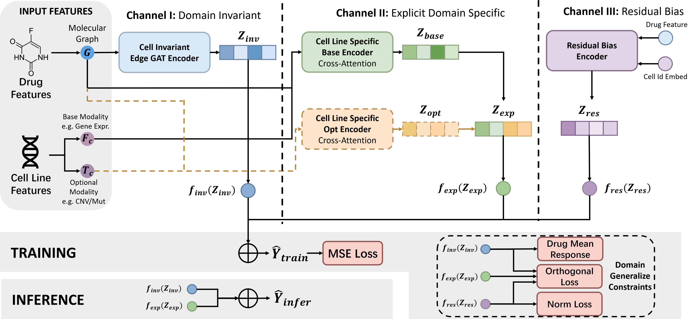

# GBD-DRP

Research code for **GBD-DRP**, a drug response prediction framework accompanying our IJCAI submission.

GBD-DRP combines drug molecular graphs and fingerprints with cell line features, including gene expression (GEP), copy number variation (CNV), and mutation (MUT). It decomposes drug responses into cell-invariant, cell-specific, and residual bias components. The repository also includes a variant for missing CNV/MUT modalities.



## Installation

The code uses Python, PyTorch, DGL, DGL-LifeSci, RDKit, NumPy, pandas, SciPy, scikit-learn, tqdm, and TensorBoard.

Install PyTorch and DGL builds compatible with your CPU/CUDA environment, then install the remaining dependencies:

```bash
python -m pip install dgllife rdkit numpy pandas scipy scikit-learn tqdm tensorboard
```

## Data

The prepared feature files and 10-fold splits are provided in `data/`:

```text
data/
├── DrugName_AND_Canonical_SMILES.csv
├── GEP_Wilcoxon_Test_Analysis_Log10_P_value_C2_KEGG_MEDICUS.csv
├── CNV_Cardinality_Analysis_of_Variance_C2_KEGG_MEDICUS.csv
├── MUT_Cardinality_Analysis_of_Variance_C2_KEGG_MEDICUS.csv
└── 10_fold_data/
    ├── mixed/        # MixedSet_{train,test}_Fold{0..9}.csv
    ├── cell_blind/   # CellBlind_{train,test}_Fold{0..9}.csv
    └── drug_blind/   # DrugBlind_{train,test}_Fold{0..9}.csv
```

Response CSVs contain `drug`, `cell_line`, and `IC50` columns. Cell feature CSVs use cell line names as the first column. Drug and cell line names must match those in the feature files.

## Usage

Run all commands from the repository root and explicitly set `--data_dir ./data` to use the included data.

Train and evaluate a single fold:

```bash
python main.py --data_dir ./data --cv_type mixed --fold 0
```

Run all 10 folds:

```bash
python main.py --data_dir ./data --cv_type cell_blind --all_folds
```

Supported split settings are `mixed`, `cell_blind`, and `drug_blind`; fold indices range from `0` to `9`.

Run a missing-modality experiment with a 50% missing rate for CNV/MUT:

```bash
python main_missing.py --data_dir ./data --cv_type cell_blind --fold 0 --missing_rate 0.5
```

By default, missing-modality masks are sampled randomly. To use fixed masks, add `--use_fixed_masks` and provide `data/missing_masks/mask_cnv_0.5.csv` and `data/missing_masks/mask_mut_0.5.csv` for the example above. Each file must contain `cell_line` and `mask` columns, where `1` means available and `0` means missing. Fixed masks are not included in this repository.

Common options include `--epochs`, `--batch_size`, `--lr`, `--embed_dim`, `--dropout`, and `--device`. Use `python main.py --help` or `python main_missing.py --help` for all options. The device defaults to CUDA when available, otherwise CPU; add `--device cpu` to select CPU explicitly.

## Outputs

Each run reports MSE, RMSE, Pearson correlation (PCC), and R². The checkpoint with the lowest validation MSE is saved as `checkpoints/<run>/best_model.pth`, and TensorBoard logs are written to `logs/<run>/`. These directories are created next to the selected data directory.

With `--data_dir ./data`, view training logs using:

```bash
tensorboard --logdir ./logs
```

## Code Structure

```text
main.py                    # Standard training and evaluation
main_missing.py            # Missing-modality experiments
src/data/dataset.py        # Feature loading and data loaders
src/models/                # Model definitions
src/training/              # Training, evaluation, and checkpointing
src/utils/graph_utils.py   # Molecular graph construction
assets/overview.png        # Framework overview
```
